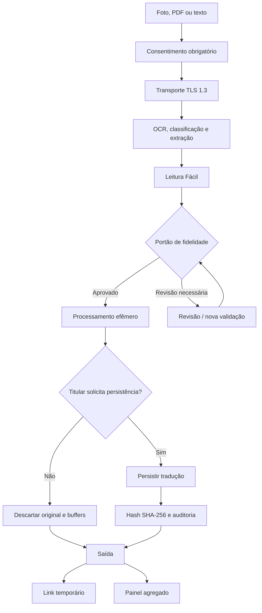

# Arquitetura conceitual da PARSE

Este documento registra o fluxo apresentado no mapa mental de arquitetura da PARSE. Ele descreve a solução pretendida, não uma infraestrutura já implantada.

## Visão geral

A plataforma é organizada em quatro camadas de dados, com controles transversais de privacidade e segurança.

| Camada | Responsabilidade | Elementos previstos |
|---|---|---|
| 1. Entrada e ingestão | Receber conteúdo e autorização | Foto, PDF ou texto; transporte TLS 1.3; consentimento obrigatório |
| 2. Processamento efêmero | Extrair e simplificar o conteúdo | OCR, classificação, extração de entidades, Leitura Fácil, portão de fidelidade, memória volátil e log auditável |
| 3. Armazenamento mínimo | Reter somente o necessário | Persistência da tradução se solicitada pelo titular, hash SHA-256, metadados agregados/anonimizados e descarte do original |
| 4. Saída e distribuição | Entregar informação e indicadores | Link temporário e painel institucional com dados agregados |

## Fluxo de referência

## Controles transversais descritos no mapa

- Conformidade com LGPD, art. 46, e descarte de buffers.
- Criptografia AES-256 em repouso.
- Trilha de auditoria append-only.
- Pseudonimização do titular.

## Decisões que precisam de especificação na implementação

O mapa define objetivos arquiteturais, mas não especifica provedor de nuvem, algoritmo de gestão de chaves, mecanismo de expiração de links, política de retenção em dias, controle de acesso detalhado, tecnologia de OCR/PLN, critérios quantitativos do portão de fidelidade ou processo de resposta a incidentes. Esses itens devem ser definidos e testados antes de qualquer uso com documentos reais.
